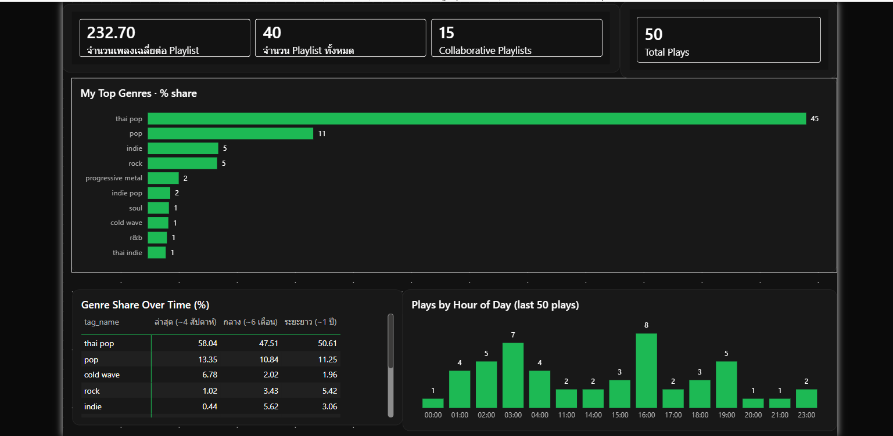

# Spotify Personal Listening Lakehouse

This project started with a simple question: what do I actually listen to, and when?
To answer it, I built a data pipeline that pulls my Spotify history every day, adds genre tags from Last.fm,
processes everything on Databricks using a Bronze → Silver → Gold layout, and shows the results in a Power BI dashboard.



## What I Learned
 
- How to build a data pipeline end to end: collect, clean, store, and visualize
- How to organize data in layers (Bronze → Silver → Gold) 
- How to deal with messy real-world data: missing values, duplicates, and inconsistent labels
- How to work around API limits and missing data

## How it fits together

```
Spotify API ──┐
              ├─► Python ingestion ─► JSON landing ─► Databricks Volume
Last.fm API ──┘   (runs daily)                             │
                                                           ▼
                                     Bronze  ─►  Silver  ─►  Gold  ─►  Power BI
                                  (Auto Loader)  (clean)   (4 tables)  (DirectQuery)
```

| Step | What it does |
|------|--------------|
| **Collect** | Python scripts pull my recently played tracks, top tracks, top artists, and playlists. Raw data is saved as JSON files, one folder per date. Windows Task Scheduler runs this every day. |
| **Bronze** | Loads the raw files into tables as-is. Only new files are loaded each time, so nothing is processed twice. |
| **Silver** | Cleans the data: turns nested data into simple columns, fixes data types, and removes duplicates. |
| **Gold** | Builds 4 tables ready for analysis: genre mix, taste over time, listening hours, and library overview. |
| **Dashboard** | Power BI reads the Gold tables directly from Databricks. |
 
## Problems that i have faced

**Spotify no longer returns artist genres,** and the audio-features endpoint returns 403 for newer apps.
I looked up each artist on Last.fm to get genre tags instead. That brought in some junk tags
(`all`, `female vocalists`), which have to be filtered out before picking the top 5 per artist,
otherwise they use up the slots. Tags that mean the same thing (`thai`, `thailand`, `t-pop`) are merged into one so a single genre isn't split across several bars.

**Spotify only returns the last 50 plays per request.** A day without a run means that day's history is gone for good,
so the landing zone is append-only and ingestion runs daily.


## Data Cleaning Details
 
**Silver layer**
- Flattened nested data (track, artists, album, etc.) into regular columns
- Removed duplicates, for example using `(track_id, played_at)` for listening history, so reloading a file doesn't create double entries
- Combined top tracks and top artists from 3 time ranges into one table with a `time_range` column
- Cleaned Last.fm tags in 4 steps:
  1. Turned each artist's list of tags into separate rows (artists with no tags are kept, with an empty tag)
  2. Removed tags that aren't genres (countries, artist names, decades, etc.)
  3. Merged tags with the same meaning (for example, `rnb` → `r&b`)
  4. Picked the top 5 tags per artist **after** cleaning, so junk tags can't take the spots

  
**Gold layer**
- Used only the latest snapshot per time range and playlist, so daily runs don't double count
- Artists with no tags are labeled "Unknown (no tag)" instead of being dropped
- Missing `context_type` values become "Unknown"
- Converted times to Asia/Bangkok before counting by hour, and avoided division by zero

## Dashboard

- KPIs: total playlists, average tracks per playlist, share of collaborative playlists, total plays
- Top 10 genres across the artists I listen to
- A heatmap of how my taste shifts across the last 4 weeks, 6 months and 12 months
- What time of day I listen (Bangkok time)

## Tech Stack
 
| Area | Tools |
|------|-------|
| Language | Python (Spotipy, pandas), PySpark, SQL |
| Data platform | Databricks (Delta Lake, Auto Loader, Unity Catalog Volumes) |
| Data sources | Spotify API, Last.fm API |
| Visualization | Power BI |
| Scheduling | Windows Task Scheduler |
 

