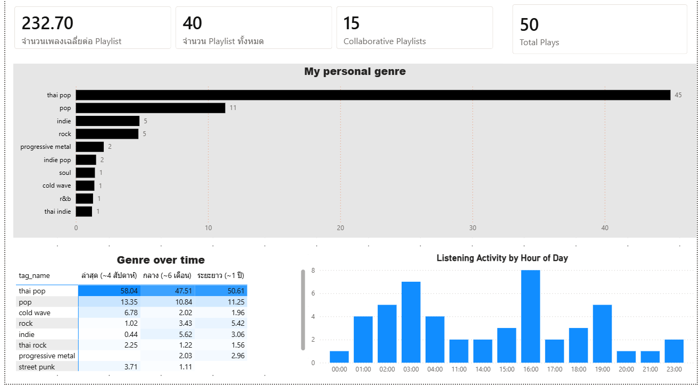

# Spotify Personal Listening Lakehouse

This project started with a simple question: what do I actually listen to, and when?
To answer it, I built a data pipeline that pulls my Spotify history every day, adds genre tags from Last.fm,
processes everything on Databricks using a Bronze → Silver → Gold layout, and shows the results in a Power BI dashboard.



## How it fits together

```
Spotify API ──┐
              ├─► Python ingestion ─► JSON landing ─► Databricks Volume
Last.fm API ──┘   (runs daily)                             │
                                                           ▼
                                     Bronze  ─►  Silver  ─►  Gold  ─►  Power BI
                                  (Auto Loader)  (clean)   (4 tables)  (DirectQuery)
```

- **Ingestion:** Python scripts pull recently played tracks, top tracks, top artists and playlists,
  and save them as raw, append-only JSON files partitioned by date. A Windows Task Scheduler job runs them daily.
- **Bronze:** loads the JSON into Delta tables with Auto Loader, incrementally, so old files are never re-read.
- **Silver:** flattens nested structs, fixes data types and removes duplicates.
- **Gold:** four analytics tables: genre mix, taste over time, listening hours, and a library overview.
- **Dashboard:** Power BI connects to a Databricks SQL warehouse and reads the Gold tables directly.

## What got in the way

**Spotify no longer returns artist genres,** and the audio-features endpoint returns 403 for newer apps.
I looked up each artist on Last.fm to get genre tags instead. That brought in some junk tags
(`all`, `female vocalists`), which have to be filtered out before picking the top 5 per artist,
otherwise they use up the slots. Tags that mean the same thing (`thai`, `thailand`, `t-pop`) are merged into one so a single genre isn't split across several bars.

**Spotify only returns the last 50 plays per request.** A day without a run means that day's history is gone for good,
so the landing zone is append-only and ingestion runs daily.

**Smaller problems:** the Kaggle CSV has rows where columns are shifted (track names with quotes), so I used `try_cast`
and filtered out the bad rows. Play times are converted from UTC to Bangkok time before counting by hour.
Power BI in DirectQuery mode rejects some DAX functions (such as `FORMAT`), so the hour labels are built with plain `IF` and `INT` instead.


## Data Cleaning
 
**Silver**
- Flattened nested structs (track, artists, album, context, owner) into plain columns and cast `played_at` to a timestamp
- Removed duplicates using a key that fits each table, for example `(track_id, played_at)` for listening history, which protects against re-loaded files
- Combined top tracks and top artists from all three time ranges into one table with a `time_range` column
- Last.fm tags (the biggest part):
  1. Exploded each artist's tag array into rows. Artists with no tags keep a row with a null tag instead of silently disappearing.
  2. Dropped tags that aren't genres, such as `all`, countries, artist names, `female vocalists` and decades
  3. Merged tags that mean the same thing, for example `thai` / `thailand` / `t-pop` into `thai pop` and `rnb` into `r&b`
  4. Picked the top 5 tags per artist per day **after** cleaning, so junk tags can't use up the slots
  
     
**Gold**
- Used only the latest snapshot per time range (and per playlist) so repeated daily runs don't double count
- Artists without tags are grouped as "Unknown (no tag)" with weight 1 instead of 0, otherwise they would always show 0%
- Null `context_type` becomes "Unknown"
- Converted play times from UTC to Asia/Bangkok before counting by hour, and guarded against division by zero

## Dashboard

- KPIs: total playlists, average tracks per playlist, share of collaborative playlists, total plays
- Top 10 genres across the artists I listen to
- A heatmap of how my taste shifts across the last 4 weeks, 6 months and 12 months
- What time of day I listen (Bangkok time)

## Tech stack

Python (Spotipy, pandas) · Databricks (Delta Lake, Auto Loader, PySpark, Unity Catalog Volumes) ·
Last.fm API · Power BI · Windows Task Scheduler

